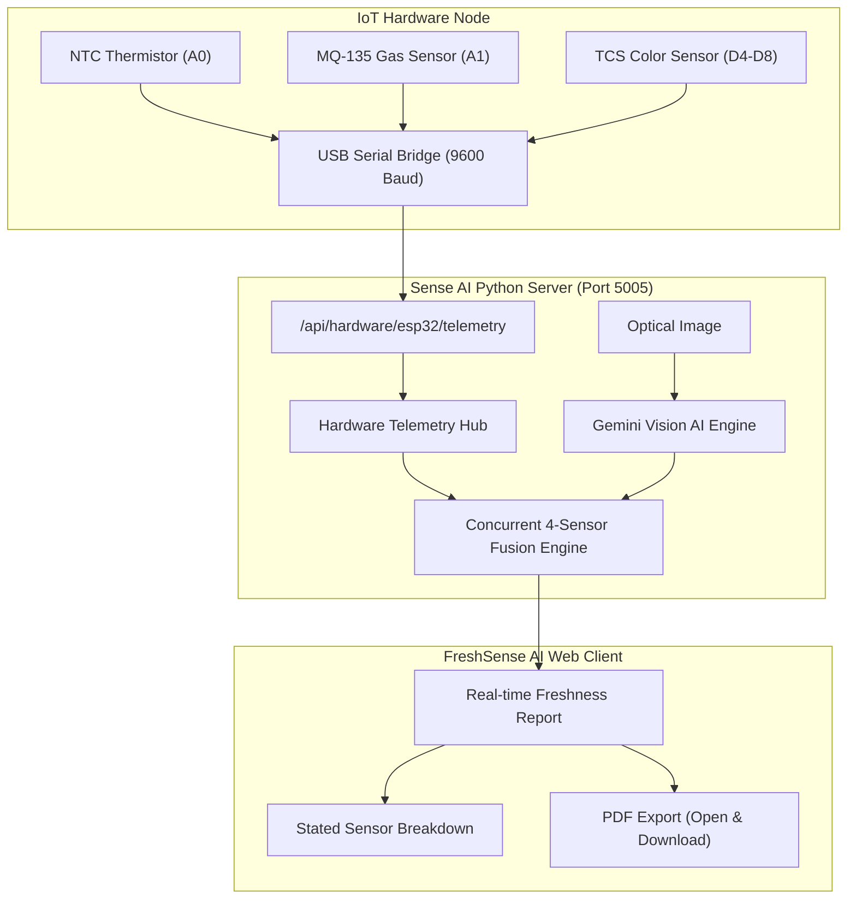

# FreshSense AI 🍏🔍
> **On-the-Spot Food Freshness Intelligence & Forensic Packaged Food Sentinel**  
> *Multimodal Computer Vision • Concurrent IoT Biosensor Fusion • Arrhenius Kinetic Degradation*

---

## 🌟 Overview

**FreshSense AI** is a unified dual-mode food safety and freshness platform designed to eliminate food waste and protect consumers:

1. **Mode A: Fresh Produce Intelligence Hub**
   - **Multimodal Visual Inspection**: Analyzes surface epidermal cell integrity, skin firmness, blemish ratio, and fungal risk.
   - **Concurrent 4-Sensor Hardware Fusion**:
     - 👁️ **Computer Vision (35% Weight)**: High-resolution surface morphology and mold detection.
     - 💨 **MQ-135 Gas Sensor (25% Weight)**: Real-time volatile organic compounds (VOCs), ethylene, and fermentation gas detection.
     - 🎨 **TCS3200 / TCS34725 Spectral Color Sensor (20% Weight)**: Chlorophyll density, carotenoid shifts, and enzymatic browning index.
     - 🌡️ **Thermal Kinetic Telemetry (20% Weight)**: Arrhenius equation modeling of temperature-accelerated cellular respiration.
   - **Actionable Freshness Report**: Stated contribution breakdown for each sensor, exact shelf-life window, storage guidelines, and zero-waste culinary recipes.
   - **Executive PDF Export**: High-fidelity certificate generation with one-click preview and download.

2. **Mode B: Packaged Food Forensic Sentinel**
   - **GS1 Multi-Format Barcode Scanner**: Multi-frame consensus engine decoding EAN-13, UPC-A, and EAN-8 with automated check-digit validation.
   - **Creative Multi-Phase Forensic Scanner**: Concentric dual-orbit holographic radar with continuous progress tracking and laser optical scanlines.
   - **Forensic Year Anchoring**: Eliminates AI hallucination by cross-checking printed ink digits against GS1 barcode metadata and shelf-life constraints.
   - **Temperature-Calibrated Safe Expiry**: Calculates true consumable days based on actual ambient storage conditions.

---

## 🚀 Quickstart Guide

### 1. Prerequisites
- **Node.js**: v18+ (v20 recommended)
- **Python**: v3.10+
- **Arduino IDE**: (Optional, for flashing physical Arduino Uno / Mini hardware)

### 2. Frontend Setup (Client)
```bash
cd client
npm install
npm run dev
```
The React + Vite application will launch at `http://localhost:5173`.

### 3. Backend Setup (Flask AI Server)
```bash
# In project root
pip install -r requirements.txt  # or install flask flask-cors pillow google-genai pyserial requests python-dateutil
python sense_backend/server.py
```
The backend server will run on `http://localhost:5005`.

### 4. Arduino Live Hardware Bridge
```bash
# Ensure Arduino Uno or Mini is plugged in via USB
python firmware/arduino_usb_bridge.py
```
The bridge automatically detects the COM port (e.g. `COM5` or `/dev/ttyUSB0`) and forwards live telemetry to the web application every 1.2 seconds.

---

## 🔌 Hardware Schematics & Pinout

Flash [`firmware/arduino_fresh_sense_sensors.ino`](firmware/arduino_fresh_sense_sensors.ino) to your **Arduino Uno** or **Arduino Mini**:

| Sensor | Arduino Pin | Measurement Function |
| :--- | :--- | :--- |
| **NTC 10k Thermistor** | `Analog Pin A0` | Biological storage temperature & respiration kinetics |
| **MQ-135 / MQ-4 Gas Sensor** | `Analog Pin A1` | Spoilage VOCs, ethylene, ethanol, and ammonia |
| **TCS3200 Color Sensor S0** | `Digital Pin 4` | Output frequency scaling |
| **TCS3200 Color Sensor S1** | `Digital Pin 5` | Output frequency scaling |
| **TCS3200 Color Sensor S2** | `Digital Pin 6` | Photodiode color filter selector |
| **TCS3200 Color Sensor S3** | `Digital Pin 7` | Photodiode color filter selector |
| **TCS3200 Color Sensor OUT** | `Digital Pin 8` | Frequency pulse output reading |

---

## 🛡️ Architecture & Verification



---

## 📄 License
MIT License. Developed for intelligent food safety and sustainability.
